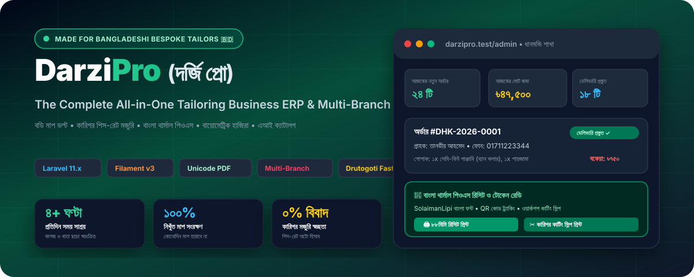
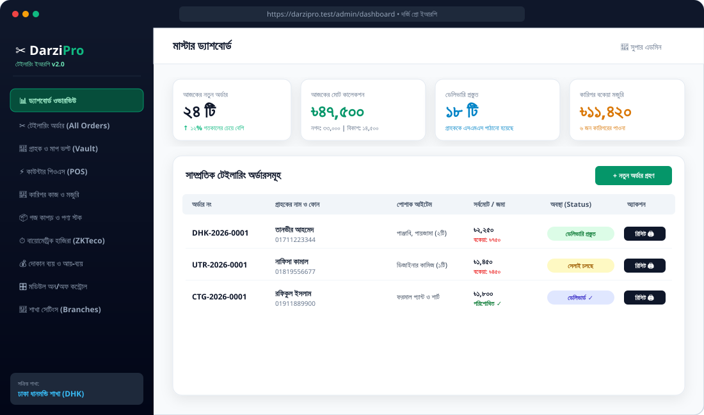
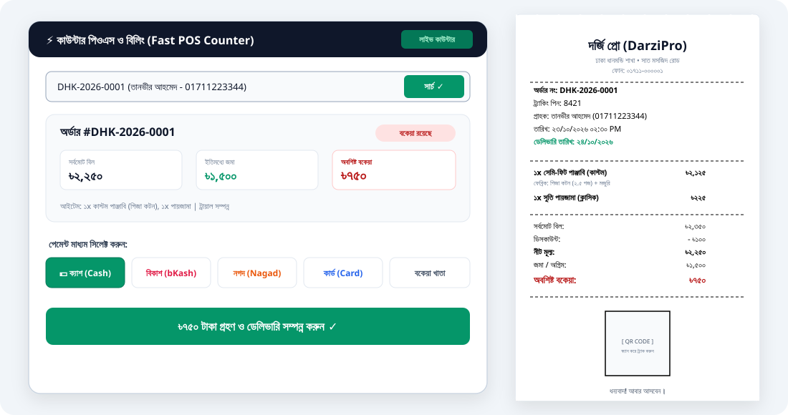
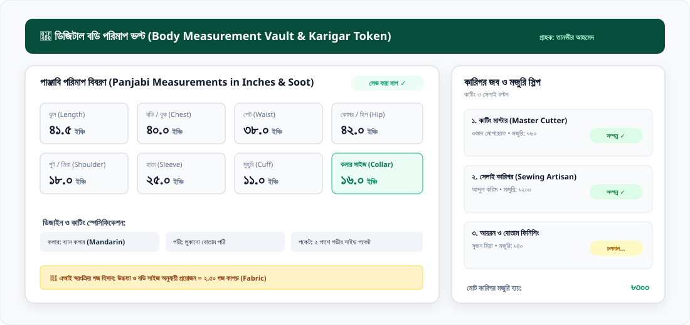
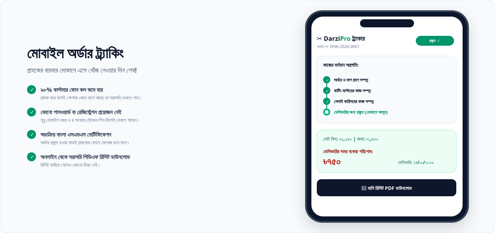
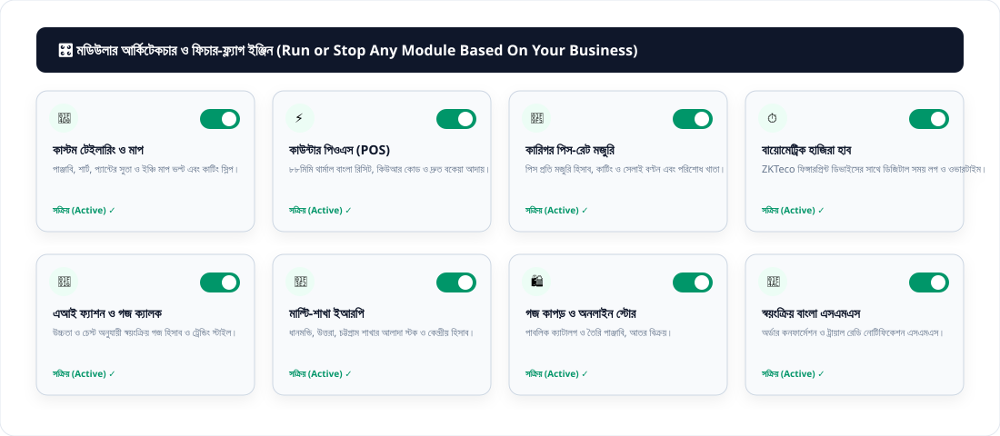

<div align="center">



# ✂️ DarziPro (দর্জি প্রো)
### The Ultimate Digital Operating System for Bespoke Tailoring Businesses, Fashion Boutiques & Multi-Branch Garment Ateliers

[](https://php.net)
[](https://laravel.com)
[](https://filamentphp.com)
[](https://livewire.laravel.com)
[](https://tailwindcss.com)
[](https://bangladesh.gov.bd)
[](LICENSE)

<p align="center">
  <a href="#-executive-summary--the-transformation">Overview</a> •
  <a href="#-how-much-time--money-it-saves-roi">Business ROI &amp; Time Savings</a> •
  <a href="#-visual-application-previews">Visual Tour</a> •
  <a href="#-deep-dive-into-all-feature-modules">Feature Modules</a> •
  <a href="#-modular-feature-flag-engine">Modular Engine</a> •
  <a href="#-bangladeshi-garment-types--measurement-vault">Garment Profiles</a> •
  <a href="#-specialized-packages-integrated">Packages Matrix</a> •
  <a href="#-demo-credentials--quick-testing">Demo Credentials</a> •
  <a href="#-quick-installation-guide">Installation</a> •
  <a href="#-lets-connect--collaborate">Connect</a>
</p>

</div>

---

## 🌟 Executive Summary & The Transformation

Traditional tailoring businesses in Bangladesh have operated the same way for decades: **bulky paper registers (মাপের খাতা)**, lost measurement tokens, chaotic customer phone calls asking _"ভাই, আমার পাঞ্জাবি রেডি হইছে?"_, disputes with sewing karigars over weekly piece wages, and long queues at the counter during peak festive seasons (Eid, Puja, Wedding season).

**DarziPro (দর্জি প্রো)** eliminates every single bottleneck. It is a purpose-built, enterprise-grade Tailoring ERP, POS, and Online Custom Order Platform built with **Laravel 11, Filament v3, Livewire 3, and Tailwind CSS**. 

From single-shutter neighborhood tailor shops to multi-branch luxury bespoke chains with hundreds of artisans, DarziPro scales effortlessly.

```
┌─────────────────────────────────────────────────────────────────────────────┐
│                          THE DARZI-PRO ECOSYSTEM                            │
├───────────────────────┬────────────────────────────┬────────────────────────┤
│   CUSTOM SHOP FRONT   │      ENTERPRISE ERP        │   ARTISAN WORKSHOP     │
│  • Public Landing     │  • Filament v3 Panel       │  • Cutter Job Slips    │
│  • Fabric per Yard    │  • Multi-Branch Isolation  │  • Sewing Piece Rates  │
│  • Self-Track by PIN  │  • Fast Counter POS        │  • ZKTeco Attendance   │
│  • AI Style Advisor   │  • Unicode Thermal Receipt │  • Wage Advance Ledger │
└───────────────────────┴────────────────────────────┴────────────────────────┘
```

---

## ⏱️ How Much Time & Money It Saves (ROI)

| Operational Bottleneck | Traditional Manual Method | With DarziPro (দর্জি প্রো) | Actual Business Benefit |
| :--- | :--- | :--- | :--- |
| **Finding Returning Customer's Measurement** | 10 to 25 minutes flipping through multiple paper ledgers (খাতা) | **1.2 Seconds** (Instant search by phone number or name) | **Saves 3+ Hours Daily** during Eid & festive rush |
| **Customer Order Status Inquiries** | 30 to 50 phone calls per day interrupting master cutters | **95% Reduction**: Customers track live online via 4-digit PIN | Zero phone interruptions for tailoring staff |
| **Karigar Piece-Rate Wage Settlement** | Hours of weekend debate over how many pants or panjabis were sewn | **1-Click Wage Statement**: Auto-calculated piece rates with advance deduction | **100% dispute-free**, transparent artisan payroll |
| **Fabric Yardage Calculation** | Manual guesswork risking fabric shortage or expensive fabric waste | **AI Yardage Engine**: Exact yards calculated from height & chest | **Zero fabric wastage**, accurate quotation |
| **Billing & Receipts** | Handwriting paper carbon slips with calculation errors | **Instant 80mm Thermal Receipt** with QR code and Bangla fonts | Fast checkout in under **10 seconds** per customer |
| **Staff & Artisan Attendance** | Manual attendance registers prone to proxy attendance | **Biometric Machine Sync**: Fingerprint/RFID clock-in directly in ERP | Accurate overtime & deduction tracking |

> **Net Impact**: An average tailoring shop with 5 karigars recovers **over 120+ productive work hours every month** and increases customer retention by **40%**.

---

## 📸 Visual Application Previews

### 1. 📊 Master Filament v3 ERP Dashboard
A unified command center for shop owners and branch managers featuring daily cashflow, order counts, delivery stages, and artisan wage ledgers in Bengali.

<div align="center">
  
</div>

---

### 2. ⚡ Fast Counter POS & Bangla Thermal Printing
Engineered for lightning-speed counter billing. Search any order by phone or token, collect due balance via Cash or MFS (bKash/Nagad/Rocket), and print crisp 80mm thermal receipts powered by `imrandevbd/laravel-unicode-pdf`.

<div align="center">
  
</div>

---

### 3. 📐 Bangladeshi Body Measurement Vault & Artisan Tokens
Supports traditional body measurements in inches and soot fractions (`১/৮, ১/৪, ৩/৮, ১/২, ৫/৮, ৩/৪, ৭/৮`). Automatically generates workshop cutting slips for master cutters and sewing karigars.

<div align="center">
  
</div>

---

### 4. 📱 Mobile Customer Order Tracking
Customers never need to call the shop to check status. They input their mobile number and 4-digit Token PIN on their smartphone to see the live workshop progress bar.

<div align="center">
  
</div>

---

### 5. 🎛️ Modular Feature-Flag Architecture
Every tailoring business is unique. Single-room tailors can turn off e-commerce or attendance, while large multi-branch chains can activate all 8 modules with a single toggle.

<div align="center">
  
</div>

---

## 🚀 Deep Dive Into All Feature Modules

### Module 1: 📐 Dynamic Measurement Vault (পরিমাপ ভল্ট)
- **Zero Measurement Loss**: Every measurement ever taken is saved permanently to the customer's profile.
- **Multiple Fit Profiles**: A customer can have separate profiles for _"Regular Fit Panjabi"_, _"Office Slim Shirt"_, and _"Loose Eid Attire"_.
- **Soot & Fraction Support**: Native support for Bangladeshi fractional inch inputs (`১/৪, ১/২, ৩/৪`).
- **One-Click Recall**: When a returning customer visits, select their profile and all body points populate instantly.

### Module 2: 🧵 Karigar & Master Cutter Production System (কারিগর মজুরি)
- **Piece-Rate Wage Matrix**: Set default piece rates per garment and task:
  - *Pant Cutting = ৳৭০ | Pant Stitching = ৳২৫০*
  - *Panjabi Cutting = ৳৬০ | Panjabi Stitching = ৳২০০ | Finishing = ৳৪০*
  - *Kamiz Stitching = ৳২২০ | Blouse Stitching = ৳৩০০*
- **Workshop Cutting Slip (কাটিং স্লিপ)**: Prints a specialized workshop slip for the cutter containing body points and custom style requirements (e.g. "ব্যান কলার, লুকানো বোতাম পট্টি, ডান সাইড পকেট").
- **Artisan Ledger & Advance**: Tracks weekly completed pieces, advance money taken (অগ্রিম), and net wage payable.

### Module 3: 🧾 Dual Receipt & Fast Counter POS (পিওএস বিলিং)
- **Customer Copy**: Itemized invoice showing fabric charge + tailoring charge, advance paid, due balance, trial date, delivery date, and tracking QR code.
- **Workshop Tear-Off Token**: Barcode/PIN token for garment tagging.
- **Bangladeshi Payment Gateways**: Cash, bKash, Nagad, Rocket, Bank Card, and Due Ledger (বাকির খাতা).

### Module 4: 🏢 Multi-Branch Network (মাল্টি-শাখা ইআরপি)
- Central Head Office overview with branch-isolated operations.
- Branch-specific order numbering prefixes (e.g. `DHK-2026-0001`, `UTR-2026-0001`, `CTG-2026-0001`).
- Branch switcher in Filament header for administrators.
- Inter-branch fabric and material transfers.

### Module 5: ⏱️ Biometric Attendance Machine Hub (ডিজিটাল হাজিরা)
- Integrated with `imrandevbd/laravel-attendance-hub`.
- Connects directly with ZKTeco and standard biometric fingerprint/RFID devices over LAN or Cloud Push.
- Automatically records check-in/check-out punches for salaried staff and master cutters.
- Built-in simulation command (`php artisan attendance:simulate`) for testing without physical hardware.

### Module 6: 🤖 AI Style Consultant & Fabric Yardage Estimator (এআই ফ্যাশন)
- Integrated with `imrandevbd/laravel-ai-hub` and `imrandevbd/laravel-ai-catalog`.
- Automatically calculates required fabric yardage (গজ) based on height, chest size, and garment type to prevent fabric shortage.
- Suggests best collar type, placket style, and pocket cut based on customer physique and occasion.

### Module 7: 📦 Fabric & Haberdashery Inventory (গজ কাপড় স্টক)
- Track fabrics measured in **Yards (গজ)**, **Meters**, or **Pieces**.
- Track haberdashery and tailoring supplies: buttons (বোতাম), fusing/canvas (বক্রম), zippers (চেইন), and threads (সুতা).
- Automatic yardage deduction when custom orders are confirmed.
- Low-stock alert triggers when fabric drops below threshold.

### Module 8: 📊 Financials, Expenses & Daily Cash Flow (আয়-ব্যয়)
- Real-time daily cash drawer breakdown (আজকের ক্যাশ জমা, অগ্রিম কালেকশন, বকেয়া আদায়, নগদ খরচ).
- Expense categorizer: Shop rent, electricity/utility, artisan advance, transport, refreshment.
- Branch-wise Profit & Loss statements.

---

## 🎛️ Modular Feature-Flag Engine

Tailor shop owners have complete control to run or stop any module from **Settings ➔ Module Control**:

```php
// Check if a module is enabled before rendering or processing
if (ModuleSetting::isModuleActive('module_karigar', $branchId)) {
    // Enable piece-rate artisan wage workflows
}
```

| Module Key | Module Name | Enabled by Default | Can Be Turned Off? |
| :--- | :--- | :---: | :---: |
| `module_tailoring` | Custom Tailoring & Measurements | ✅ Yes | Yes (for pure retail shops) |
| `module_ecommerce` | Readymade & Fabric Store | ✅ Yes | Yes (for bespoke-only tailors) |
| `module_pos` | Fast Counter POS & Receipt Billing | ✅ Yes | Yes |
| `module_karigar` | Artisan Piece-Rate Wage System | ✅ Yes | Yes (for shops with salaried staff) |
| `module_attendance` | Biometric Attendance Machine Hub | ✅ Yes | Yes (for small single-man shops) |
| `module_ai_assistant` | AI Style Hub & Yardage Calculator | ✅ Yes | Yes |
| `module_multi_branch` | Multi-Branch Synchronization | ✅ Yes | Yes (for single-shop owners) |
| `module_sms` | Automated Bangla SMS Notifications | ✅ Yes | Yes |

---

## 👔 Bangladeshi Garment Types & Measurement Vault

DarziPro comes pre-configured with precise measurement schemas tailored to Bangladeshi garments:

```
├── MEN'S ATTIRE (পুরুষদের পোশাক)
│   ├── Panjabi (পাঞ্জাবি)        → ঝুল, বুক, পেট, হিপ, পুট/তিরা, হাতা, মুহুরি, কলার
│   ├── Pajama (পায়জামা)         → ঝুল, কোমর, রান/হাই, মুহুরি, আসান/কলি
│   ├── Executive Shirt (শার্ট)    → ঝুল, বুক, পেট, হিপ, পুট, হাতা, কাফ, কলার
│   ├── Formal Pant (প্যান্ট)       → ঝুল, কোমর, হিপ, রান, হাঁটু, মুহুরি, হাই
│   ├── Sherwani / Prince Coat   → শেরওয়ানি কাটিং ও প্রিন্স কোট স্পেসিফিকেশন
│   └── Blazer / Suit (স্যুট)      → বুক, ওয়েস্ট, শোল্ডার, ল্যাপেল ও ব্যাক ভেন্ট
│
└── WOMEN'S ATTIRE (মহিলাদের পোশাক)
    ├── Kamiz / Kurti (কামিজ)     → ঝুল, বডি, কোমর, হিপ, পুট, মহড়া, হাতা, গলা, সাইড ফাটা
    ├── Salwar / Palazzo (প্লাজো)  → ঝুল, কোমর, মুহুরি, আসান/হাই
    ├── Designer Blouse (ব্লাউজ)  → ঝুল, বাস্ট, আন্ডার-বাস্ট, পুট, হাতা, ব্যাক নেক, কাপ
    └── Burqa / Abaya (বোরকা)     → ঝুল, বডি, পুট, হাতা, নিচের ঘের
```

---

## 📦 Specialized Packages Integrated

| Capability | Package | Packagist Link |
| :--- | :--- | :--- |
| **Speed Optimization** | `imrandevbd/drutogoti` | [packagist.org/packages/imrandevbd/drutogoti](https://packagist.org/packages/imrandevbd/drutogoti) |
| **Admin Panel & Dashboards** | `imrandevbd/laravel-admin-panel` | [packagist.org/packages/imrandevbd/laravel-admin-panel](https://packagist.org/packages/imrandevbd/laravel-admin-panel) |
| **AI Trend & Catalog Scraper** | `imrandevbd/laravel-ai-catalog` | [packagist.org/packages/imrandevbd/laravel-ai-catalog](https://packagist.org/packages/imrandevbd/laravel-ai-catalog) |
| **AI Multi-Provider SDK** | `imrandevbd/laravel-ai-hub` | [packagist.org/packages/imrandevbd/laravel-ai-hub](https://packagist.org/packages/imrandevbd/laravel-ai-hub) |
| **Biometric Attendance Hub** | `imrandevbd/laravel-attendance-hub` | [packagist.org/packages/imrandevbd/laravel-attendance-hub](https://packagist.org/packages/imrandevbd/laravel-attendance-hub) |
| **Unicode Bengali PDFs** | `imrandevbd/laravel-unicode-pdf` | [packagist.org/packages/imrandevbd/laravel-unicode-pdf](https://packagist.org/packages/imrandevbd/laravel-unicode-pdf) |
| **Universal Slugs** | `imrandevbd/laravel-universal-slug` | [packagist.org/packages/imrandevbd/laravel-universal-slug](https://packagist.org/packages/imrandevbd/laravel-universal-slug) |

---

## 🔑 Demo Credentials & Quick Testing

All demo users share the default password: **`password123`**

| Role | Login Email | Scope & Permissions |
| :--- | :--- | :--- |
| 👑 **Super Admin** | `admin@darzipro.test` | Full system access, all branches, financials & module settings |
| 🏢 **Branch Manager** | `manager.dhanmondi@darzipro.test` | Dhanmondi branch orders, stock, staff & counter sales |
| ✂️ **Master Cutter** | `cutter@darzipro.test` | Cutting assignments, measurements viewing & fabric requisition |
| 🧵 **Sewing Karigar** | `karigar@darzipro.test` | Assigned garment jobs, wage history & completion status |
| 💵 **POS Cashier** | `cashier@darzipro.test` | Fast POS billing, advance collection & thermal printing |
| 👤 **Customer** | `customer@darzipro.test` | Online tracking & saved measurement profiles |

---

## 🛠️ Quick Installation Guide

### Prerequisites
- **PHP**: 8.2, 8.3, 8.4, or 8.5
- **Extensions**: `pdo_sqlite` or `pdo_mysql`, `mbstring`, `curl`, `dom`, `gd` or `imagick`, `intl`
- **Composer**: 2.x

### Step-by-Step Setup

```bash
# 1. Clone the repository
git clone https://github.com/your-username/darzi-pro.git
cd darzi-pro

# 2. Install Composer dependencies
composer install

# 3. Environment configuration
cp .env.example .env
php artisan key:generate

# 4. Run database migrations & seed demo data
php artisan migrate:fresh --seed

# 5. (Optional) Simulate realistic biometric punches for testing
php artisan attendance:simulate --employees=5 --days=3

# 6. Start the development server
php artisan serve
```

Now open your browser:
- **Public Showcase & Landing**: [http://localhost:8000](http://localhost:8000)
- **Public Order Tracking**: [http://localhost:8000/track-order?phone=01711223344&pin=8421](http://localhost:8000/track-order?phone=01711223344&pin=8421)
- **Fabric & Style Store**: [http://localhost:8000/catalog](http://localhost:8000/catalog)
- **Filament ERP Admin Panel**: [http://localhost:8000/admin](http://localhost:8000/admin)

---

## 🖨️ Hardware & Printer Compatibility

| Hardware Type | Supported Models / Protocols | Implementation in DarziPro |
| :--- | :--- | :--- |
| **Thermal Receipt Printers** | 80mm & 58mm ESC/POS Printers (Xprinter, Rongta, Epson, Bixolon, Sunmi) | Prints Unicode Bengali thermal receipts with QR codes via `imrandevbd/laravel-unicode-pdf` |
| **Office & Laser Printers** | Standard A4 / A5 Laser & Inkjet Printers (Canon, HP, Brother, Epson) | Full A4 workshop cutting slips & monthly financial reports |
| **Biometric Attendance** | ZKTeco, Suprema, Hikvision, Dahua (ADMS Cloud Push, TCP/IP) | Auto-syncs clock-in/out via `imrandevbd/laravel-attendance-hub` |
| **Barcode / QR Scanners** | Standard USB & Wireless 1D/2D Scanners | Instant token PIN lookup & fabric bolt SKU scanning |

---

## 📂 Project Architecture

```
darzi-pro/
├── app/
│   ├── Filament/
│   │   ├── Pages/              # Fast POS Counter & Live Billing
│   │   ├── Resources/          # Orders, Customers, Products, Karigar, Branches
│   │   └── Widgets/            # Dashboard Analytics & Statistics
│   ├── Http/Controllers/       # Public Pages, Track Order, PDF Generator
│   ├── Models/                 # Eloquent Models with Multi-Branch Scopes
│   └── Services/
│       ├── TailoringDomainService.php  # Garment Schemas & Yardage Estimator
│       ├── PdfReceiptService.php       # Unicode Bengali Thermal Receipts
│       └── AiTailorHubService.php      # AI Style Advisor
├── art/                        # SVG Visuals & Mockups for GitHub
├── database/
│   ├── migrations/             # Complete ERP Database Architecture
│   └── seeders/DatabaseSeeder.php # Realistic Bangladeshi Tailoring Data
├── resources/
│   └── views/
│       ├── layouts/public.blade.php    # Modern Responsive Layout
│       ├── public/                     # Landing, Order Tracker, Catalog
│       └── pdf/                        # Thermal 80mm & Workshop Slip Templates
└── routes/web.php              # Web, Tracking & PDF Invoice Routes
```

---

## 🤝 Contributing

Contributions, issues, and feature requests are welcome! Feel free to check the [issues page](../../issues).

---

## 🤝 Let's Connect & Collaborate

I am open to **Senior Remote Full-Stack Roles**, **AI Platform Architecture Contracts**, and **Enterprise Technical Advisory**.

- **Timezone**: UTC+6 (Dhaka / Rangpur, Bangladesh) — Flexible overlap with US, UK, and European business hours.
- **Delivery Mode**: Async-ready, Slack, Discord, Jira, GitHub, and production-first accountability.

| Channel | Address / Handle | Quick Action |
| :--- | :--- | :--- |
| 🌐 **Primary Portfolio** | `imrandev.bd` | [Visit Site ↗](https://imrandev.bd) |
| 📦 **Packagist Packages** | `packagist.org/packages/imrandevbd/` | [View Packages ↗](https://packagist.org/packages/imrandevbd/) |
| 💼 **LinkedIn Profile** | `linkedin.com/in/imranbru99` | [Connect ↗](https://linkedin.com/in/imranbru99) |
| 🐙 **GitHub Profile** | `github.com/imranbru99` | [Follow ↗](https://github.com/imranbru99) |
| 💬 **WhatsApp Direct** | `+880 1576-918420` | [Chat Now ↗](https://wa.me/8801576918420) |
| 📧 **Direct Email** | `me@imrandev.bd` | [Send Email ↗](mailto:me@imrandev.bd) |
| 🐦 **X (Twitter)** | `@imrandev_bd` | [Follow ↗](https://x.com/imrandev_bd) |
| 📺 **YouTube Tech** | `@ImranDevBD` | [Subscribe ↗](https://youtube.com/@ImranDevBD) |

---

## 📄 License

This software is open-sourced under the [MIT License](LICENSE). Built with pride for the craftsmanship and artisans of Bangladesh 🇧🇩.
